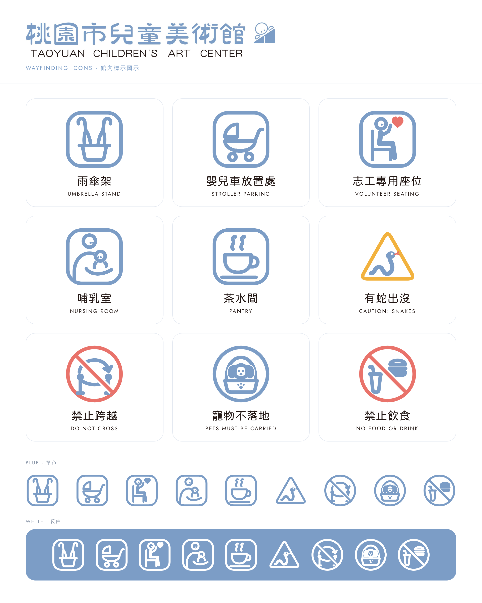

# 桃園市兒童美術館 館內標示圖示

依標準字風格繪製的館內標示 icon：粗細一致的圓頭線條、圓角外框、人物與動物沿用吉祥物「圓頭＋兩點眼睛」的表情。



| # | 圖示 | English | 類型 |
|---|---|---|---|
| 01 | 雨傘架 | Umbrella Stand | 資訊（圓角方框） |
| 02 | 嬰兒車放置處 | Stroller Parking | 資訊 |
| 03 | 志工專用座位 | Volunteer Seating | 資訊 |
| 04 | 哺乳室 | Nursing Room | 資訊 |
| 05 | 茶水間 | Pantry | 資訊 |
| 06 | 有蛇出沒 | Caution: Snakes | 警告（圓角三角） |
| 07 | 禁止跨越 | Do Not Cross | 禁止（圓框＋斜線） |
| 08 | 寵物不落地 | Pets Must Be Carried | 規範（藍色圓框） |
| 09 | 禁止飲食 | No Food or Drink | 禁止 |

## 檔案

- `svg/color/` 彩色版：藍色主體，禁止用珊瑚紅、警告用琥珀黃
- `svg/blue/` 單色藍版
- `svg/white/` 反白版（透明底白線，放在深色或藍色底上使用）
- `signs/light/`、`signs/dark/` 含中英文字的橫式標示牌（500×160，文字已轉外框，不需安裝字型）
- `png/` 以上全部的 PNG（icon 512×512 透明底；標示牌 1000×320）

所有 SVG 皆為透明底，可直接匯入 Illustrator / Figma 編修；留白處用 mask 處理，不是白色色塊。

## 色彩

| 用途 | 色碼 |
|---|---|
| 標準字藍（取自 logo） | `#7C9DC6` |
| 文字黑（取自 logo 英文） | `#231815` |
| 禁止 | `#E9736B` |
| 警告 | `#F2B23E` |

## 字型

標示牌中文用 jf 粉圓（Huninn），英文用 Jost，皆為 SIL OFL 開源授權，可商用。

## 重新產生

圖形定義在 `tools/icons.py`（120×120 畫布）。修改後：

```bash
# 字型放在 tools/fonts/（Huninn-Regular.ttf、Jost-Regular.ttf），或用 ICON_FONT_DIR 指定
LOGO=path/to/logo.jpg python3 tools/build.py   # 需要 pip install fonttools
node tools/render.js                           # 需要 playwright
```
